<div align="center">



<a href="https://github.com/imlean64-gif">
  
</a>

<br/>


<br/><br/>


<h2 align="center">◢ SOBRE MIM ◣</h2>

</div>

```yaml
┌──[ PERFIL ]────────────────────────────────────────────
│ nome      : Diblaim Palmeira
│ local     : Salvador, Bahia - Brasil
│ funcao    : Estudante de Desenvolvimento de Software
│ foco      : Back-end | Automação | Boas práticas
│ linguagens: Java, Python, JavaScript
│ status    : Disponível para estágio e oportunidades
└────────────────────────────────────────────────────────
```

Sou estudante de Desenvolvimento de Software e trabalho principalmente com **Java**, **Python** e **JavaScript**. Busco escrever código organizado, documentado e fácil de manter, e uso projetos práticos para consolidar o que aprendo.

<div align="center">


<h2 align="center">◢ TECH STACK ◣</h2>

<h4>Linguagens</h4>


&nbsp;&nbsp;

&nbsp;&nbsp;


<h4>Web</h4>


&nbsp;&nbsp;


<h4>Dados e versionamento</h4>


&nbsp;&nbsp;


<br/><br/>

<h2 align="center">◢ FERRAMENTAS ◣</h2>


<br/><br/>


<h2 align="center">◢ PROJETOS EM DESTAQUE ◣</h2>

<!-- Edite o nome, a descricao, a linguagem e o link de cada projeto -->
<table>
  <tr>
    <td width="50%" valign="top">
      <a href="https://github.com/imlean64-gif?tab=repositories"><b>Nome do projeto 1</b></a><br/>
      Descrição curta do que ele faz.<br/><br/>
      
    </td>
    <td width="50%" valign="top">
      <a href="https://github.com/imlean64-gif?tab=repositories"><b>Nome do projeto 2</b></a><br/>
      Descrição curta do que ele faz.<br/><br/>
      
    </td>
  </tr>
  <tr>
    <td width="50%" valign="top">
      <a href="https://github.com/imlean64-gif?tab=repositories"><b>Nome do projeto 3</b></a><br/>
      Descrição curta do que ele faz.<br/><br/>
      
    </td>
    <td width="50%" valign="top">
      <a href="https://github.com/imlean64-gif?tab=repositories"><b>Nome do projeto 4</b></a><br/>
      Descrição curta do que ele faz.<br/><br/>
      
    </td>
  </tr>
</table>

<br/><br/>


<h2 align="center">◢ OBJETIVOS ATUAIS ◣</h2>



<br/><br/>


<h2 align="center">◢ ESTATÍSTICAS DO GITHUB ◣</h2>


<br/><br/>


<h2 align="center">◢ TROFÉUS ◣</h2>

<a href="https://github.com/ryo-ma/github-profile-trophy">
  
</a>

<br/><br/>


<h2 align="center">◢ CONTRIBUIÇÕES ◣</h2>

<picture>
  <source media="(prefers-color-scheme: dark)" srcset="https://raw.githubusercontent.com/imlean64-gif/imlean64-gif/output/github-snake-dark.svg"/>
  <source media="(prefers-color-scheme: light)" srcset="https://raw.githubusercontent.com/imlean64-gif/imlean64-gif/output/github-snake.svg"/>
  
</picture>

<br/><br/>


<h2 align="center">◢ CONTATO ◣</h2>

<a href="https://linkedin.com/in/seu-usuario"></a>
<a href="mailto:imlean64@gmail.com"></a>
<a href="https://github.com/imlean64-gif"></a>
<a href="https://seuportfolio.com"></a>

<br/><br/>



</div>
